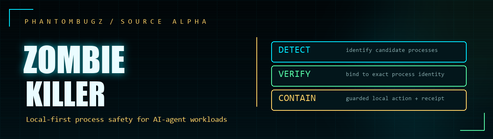
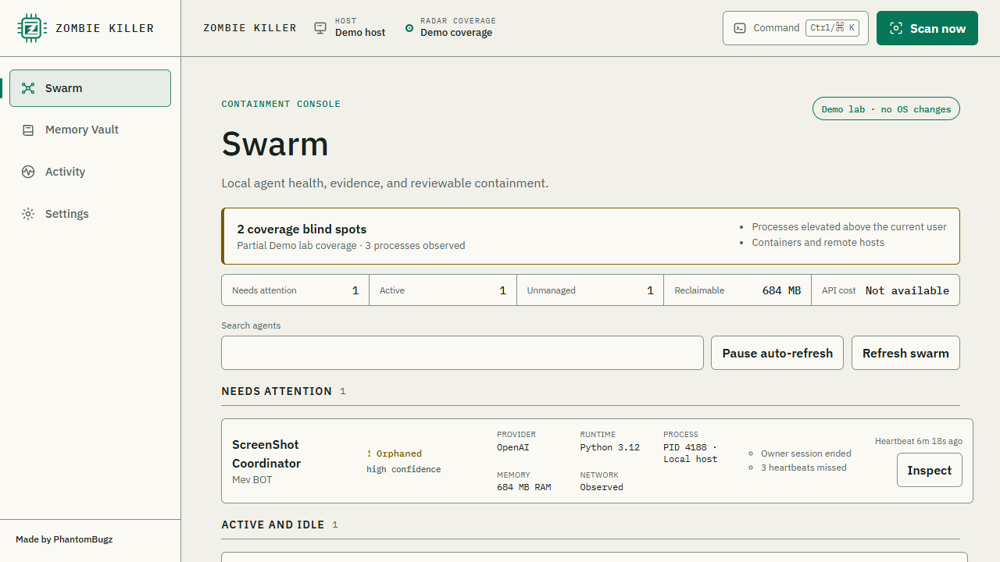

# Zombie Killer

> A local-first containment console for Agentic AI processes and supported local memory stores.




**Made by [PhantomBugz](https://PhantomBugz.com)**

**Source release:** [`v0.1.0-alpha.1`](https://github.com/PhantomBugz/Zombie-Killer-AI/releases/tag/v0.1.0-alpha.1). This source alpha contains source archives only; no prebuilt native executable or signed installer is attached.

The [project page](https://phantombugz.com/zombie-killer.html) tracks public availability. Use only downloads linked from a verified project release; the browser preview is synthetic and does not exercise native process actions.



*Synthetic browser demo with fixture agents and no OS changes. This image does not verify the native executable.*

Zombie Killer helps an operator see and review agent workloads that outlive a UI, lose their supervising parent, or stop heartbeating. It combines a process-evidence dashboard, reviewed local containment, declared-resource quarantine and restore, supported memory repair, a headless engine, and a tiny Python lifecycle SDK.

The name is playful; the evidence model is not. A true POSIX zombie is a **defunct process that has already exited** while its parent has not collected the exit status. It consumes a process-table slot, not active CPU or API calls, and cannot be killed again. Zombie Killer labels that state `defunct` and separately diagnoses live orphaned, stale, unmanaged, and stalled candidates.

> [!WARNING]
> This is alpha developer software. Review every preview and keep independent backups. Source builds are not signed installers. Platform permissions, process visibility, and supported mutations vary; an empty scan is not proof that no agent is running.

**Alpha platform scope:** Windows and Ubuntu Linux are the source qualification targets. macOS native builds and mutation workflows remain experimental and unqualified; CI checks only scanner unit tests and the browser frontend on macOS. No macOS native artifact is offered.

## What is implemented

| Area | Alpha status | Boundary |
| --- | --- | --- |
| Swarm radar | Implemented | Current-user process evidence, SDK leases, explicit coverage warnings, deterministic classifications |
| Process actions | Domain plan/execute primitives are implemented; the identity-bound CLI and reviewed native stop transport are enabled only when the engine confirms a kernel-stable process binding | Windows uses stable process handles. Linux requires both `pidfd_open` and `pidfd_send_signal` plus a successful runtime pidfd bind probe. macOS native support is unqualified and current code declines process actions; plans remain short-lived, immutable, and revalidated before signals |
| Graveyard | Reviewed quarantine of complete SDK temporary-resource declarations and exact-entry restore in the service, desktop, and CLI | Unchanged approved root, registration identity/nonce, and resource fingerprint are required; legacy path-only declarations do not authorize cleanup; restore never overwrites |
| Memory Vault | Explicit source registration, supported scalar repairs, verified snapshots, and planned restore | JSON/JSONL require cooperative or paused writers; SQLite uses constrained transactions and schema-gated restore; Chroma and supported FAISS headers remain inventory-only |
| Activity/receipts | Durable mixed-operation receipts, lookup, and explicit local diagnostics export | Export excludes private memory drafts and sensitive content, preserves existing destinations, and reports uncertainty without relabeling success |
| Python SDK | Lifecycle leases, cancellation-safe async startup, cooperative cancellation, and root/fingerprint resource declarations | Registration never triggers cleanup; counters are caller-measured and changed resources require fresh declarations |
| Desktop | Tauri/React shell and capability-gated local recovery workflows; synthetic browser demo | Browser demo flows do not prove native capabilities; platform actions depend on actual engine support |
| Signed installers and package-registry publication | Not implemented | Human-owned signing/notarization and release approval are required |

See the [roadmap](ROADMAP.md) for planned work and [architecture](docs/architecture.md) for the trust boundaries.

See the [local workflow guide](docs/local-workflows.md) for memory repair, cleanup, restore, and headless commands. Signing, platform release approval, and clean-machine installation remain separate from local source/build verification.

## Safety and privacy, by default

- No product telemetry, provider API calls, remote integrations, or application-controlled inbound network listener.
- No prompt, response body, process environment, or provider credential collection.
- No automatic killing. Mutating operations use preview, digest, expiry, confirmation, revalidation, and receipts.
- No billing inference. Cost is unknown unless an instrumented agent reports measured data.
- No claim that editing local memory changes provider safety systems, account status, rate limits, or guarantees task continuation.
- No provider safety, account, or rate-limit bypass features.
- Signature-only process matches remain `unmanaged`; they are not treated as confirmed agents.

Read [Privacy](PRIVACY.md), [Responsible Use](RESPONSIBLE_USE.md), and the [threat model](docs/threat-model.md) before operating on important workloads.

## Quick start

### One-command synthetic browser demo

From a source checkout with Node.js `24.18.0` and pnpm `10.33.2` through Corepack already installed, run:

```shell
pnpm demo
```

This installs the lockfile-pinned JavaScript dependencies, then starts the synthetic browser preview on `127.0.0.1`. Open the localhost URL printed by Vite; press Ctrl+C to stop it. The preview uses fixture agents and cannot inspect or mutate host processes. The first install may need network access. Python, Rust, and Tauri system prerequisites are for the full source or native workflows below.

### Full source and native prerequisites

- Git
- PowerShell 7 or newer (`pwsh`)
- Node.js `24.18.0`
- pnpm `10.33.2` through Corepack
- Python `3.11`–`3.13` and `uv 0.12.3`
- Rust `1.97.1` for native builds
- The [Tauri 2 system prerequisites](https://v2.tauri.app/start/prerequisites/) for Windows or Linux native builds

The repository rejects mismatched Node or pnpm versions in CI. Do not use the documented local bootstrap bypass for release verification.

Clone the repository if your GitHub account can access it, or use an existing source checkout. The commands below run the broader source checks; the synthetic browser demo above needs only its stated prerequisites.

### Windows (PowerShell 7)

```powershell
git clone https://github.com/PhantomBugz/Zombie-Killer-AI.git
Set-Location Zombie-Killer-AI
corepack enable
corepack prepare pnpm@10.33.2 --activate
python -m pip install uv==0.12.3
uv sync --frozen
pnpm install --frozen-lockfile
pnpm verify:web
```

### Linux

```bash
git clone https://github.com/PhantomBugz/Zombie-Killer-AI.git
cd Zombie-Killer-AI
corepack enable
corepack prepare pnpm@10.33.2 --activate
python3 -m pip install uv==0.12.3
uv sync --frozen
pnpm install --frozen-lockfile
pnpm verify:web
```

The macOS browser preview can be built from source, but its frontend and scanner unit checks do not qualify a native app. Do not treat a macOS source build as a supported alpha artifact.

`pnpm verify:web` checks public docs and the browser UI; it does not verify the native app. The full [source-release gate](docs/release-verification.md) builds and tests the native app on Windows and Linux. On Windows, run that full gate only in a disposable user profile or a GitHub-hosted runner because the engine can write to OS-known current-user state. Platform-specific process access and filesystem primitives can cause explicit skips or reduced coverage. The CI matrix is the public record of tested platforms.

## Run it

### Windows native ZIP verification build

If you have a built `unsigned-native-windows-<architecture>.zip`, right-click it and choose **Extract All**. Open the extracted folder and double-click **Start Zombie Killer.cmd**. Keep the whole folder together: the launcher starts the native app with its packaged engine, not the browser demo. No Node, Python, or Rust installation is needed to run that package; Windows still needs the Tauri/WebView2 system prerequisites. It remains an unsigned alpha verification build, not a signed installer.

### Windows single-file portable executable

If a verified `Zombie Killer.exe` and its `SHA256SUMS` are supplied with a release, check the executable's hash before opening it. This unsigned Windows x64 alpha build embeds the same native app and engine as the ZIP, extracts them into a fresh directory under `%LOCALAPPDATA%` for each run, and removes that directory after a normal exit. It requires an installed WebView2 runtime, but no Node, Python, or Rust installation. Forced termination can leave an extraction directory behind. See the [portable Windows guide](docs/portable-windows.md) for the build, `--check` diagnostic, and cleanup details. Check [GitHub Releases](https://github.com/PhantomBugz/Zombie-Killer-AI/releases) for current download availability; a source checkout is not a prebuilt executable.

### From source

Browser preview with deterministic synthetic data and no host actions:

```powershell
pnpm --filter @zombie-killer/desktop dev --host 127.0.0.1
```

Native desktop development build, after installing Tauri prerequisites:

```powershell
pnpm --filter @zombie-killer/desktop tauri dev
```

Headless engine:

```powershell
uv run zk doctor
uv run zk scan --json
uv run zk action plan <agent-id> --pid <pid> --process-instance-id <64-hex-id> --mode request_stop
uv run zk action execute <plan-id> <digest> --confirm
```

Copy the PID and process-instance ID from the same fresh scan you reviewed. The CLI never selects a target from the agent ID alone, and a restarted or PID-reused process is rejected as `target_changed`.

Process actions are available on Windows and on Linux hosts where both required pidfd primitives pass the engine's non-signaling runtime bind probe. On Linux hosts where pidfd is missing or rejected by the running kernel, `zk doctor` reports `action.plan` and `action.execute` unavailable; scanning and inspection remain read-only. The current macOS engine code also declines process actions, but macOS native operation has not completed alpha qualification.

For `zk action execute`, exit code `0` means the engine returned a valid local receipt; it does
not by itself mean the action completed. The human-readable output distinguishes verified
completion, issued-but-pending work, failed-before-issue results, partial failures, and uncertain
outcomes. Automation should use `--json` and inspect `outcome`, `certainty`, `action_issued`, and
`partial_failures`. Usage or missing-confirmation errors exit `2`; rejected or failed engine
requests exit `4` with a bounded message.

Production-quality source checks and unsigned native compilation:

```powershell
pnpm verify
uv build --package zombie-killer-engine
uv build --package zombie-killer-sdk
pnpm --filter @zombie-killer/desktop tauri build --no-bundle
```

`--no-bundle` produces a native executable for local verification; it does not produce a signed or notarized installer.

## Add lifecycle context to an agent

```python
from zombie_killer import Agent

with Agent(provider="google-gemini", project="MTGA Cardbot", role="Search Bot") as agent:
    agent.status("Searching local card files")
    if agent.cancelled:
        raise SystemExit(0)
```

The SDK continues safely when Zombie Killer is absent. Status fields are bounded and redacted, but must never contain prompts, credentials, personal data, or arbitrary exception text. See the [SDK guide](docs/sdk.md).

## Documentation

- [Architecture and data flow](docs/architecture.md)
- [Detection and evidence model](docs/detection-model.md)
- [Cleanup and process safety](docs/cleanup-safety.md)
- [Memory Vault](docs/memory-vault.md)
- [Desktop and headless local workflows](docs/local-workflows.md)
- [Portable Windows executable](docs/portable-windows.md)
- [Release verification](docs/release-verification.md)
- [Security policy](SECURITY.md)
- [Contributing](CONTRIBUTING.md)
- [Optional donations](DONATIONS.md)

## More from PhantomBugz

[liveD LoRA Studio](https://github.com/PhantomBugz/lived-lora-studio) is our Apache-2.0 developer preview for reviewed LoRA workflows. Its public demo uses synthetic data; training is pending. Explore the projects at [PhantomBugz](https://phantombugz.com/).

## License and attribution

Code is licensed under [Apache License 2.0](LICENSE). The original Zombie Killer mark is licensed under [CC BY 4.0](LICENSES/CC-BY-4.0.txt); attribution details are in [NOTICE](NOTICE). Bundled fonts and dependency notices are recorded in [Third-Party Notices](THIRD_PARTY_NOTICES.md).

Copyright 2026 PhantomBugz. “Zombie Killer” and the original project branding are addressed by the [trademark policy](TRADEMARKS.md).
